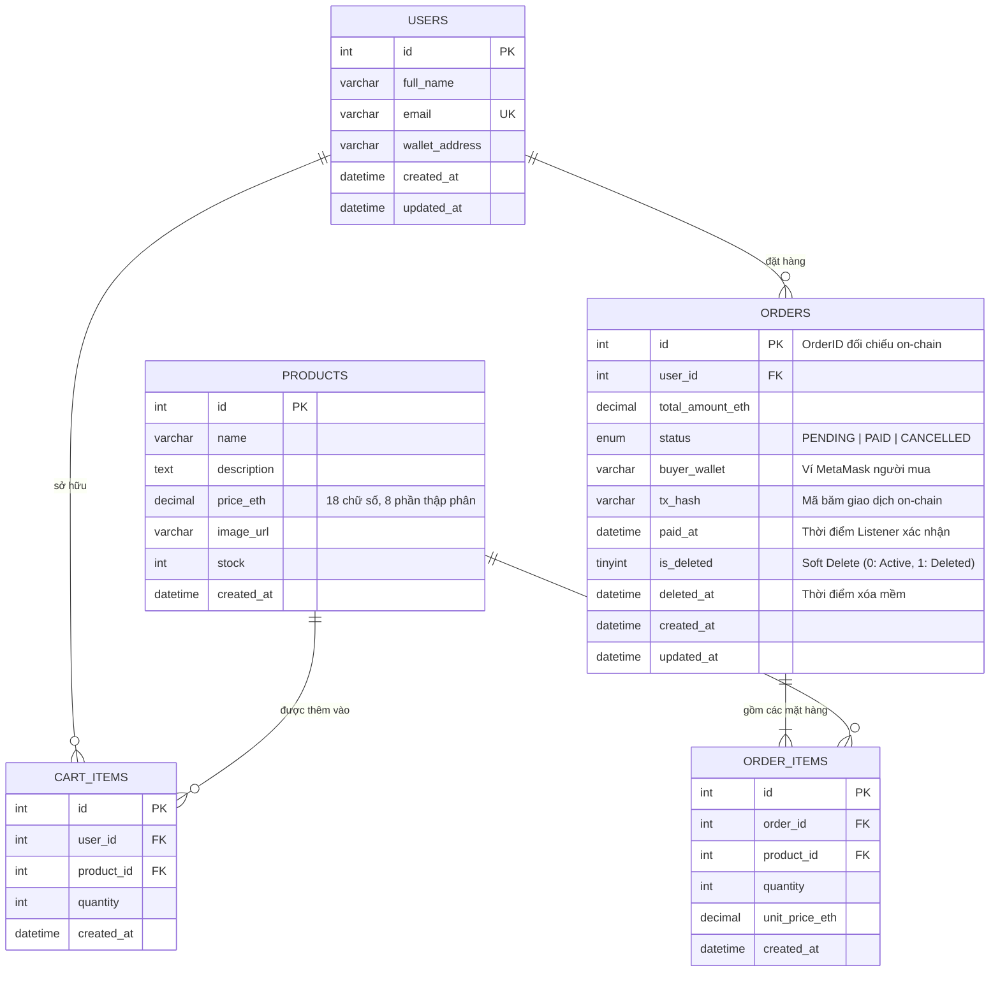

# Tài liệu Thiết kế CSDL & Phân tích Kiến trúc Hybrid DApp
**Thành viên 1: Database & Smart Contract (Data Layer)**

---

## 1. Bản chất Kiến trúc Hybrid DApp (Off-chain vs On-chain)
Trong các ứng dụng phi tập trung kết hợp (Hybrid DApp), chi phí lưu trữ dữ liệu trực tiếp trên mạng lưới Blockchain (On-chain) là rất đắt đỏ (Gas fee) và tốc độ ghi giao dịch phụ thuộc vào thời gian tạo khối (Block time). Do đó, phân tách dữ liệu hợp lý là nguyên tắc sống còn:

| Phân loại | Dữ liệu | Nơi lưu trữ | Lý do kỹ thuật |
| :--- | :--- | :--- | :--- |
| **Off-chain** | Thông tin người dùng (`users`), danh mục sản phẩm (`products`), giỏ hàng (`cart_items`), chi tiết dòng hàng (`order_items`). | Cơ sở dữ liệu **MySQL** | Tốc độ truy vấn cao (millisecond), hỗ trợ tìm kiếm/lọc phong phú, tiết kiệm 100% Gas fee cho các thao tác CRUD thông thường. |
| **On-chain** | Giá trị tiền nạp (ETH), bằng chứng thanh toán (`PaymentCompleted` event), mapping trạng thái thanh toán theo OrderID. | **Smart Contract** (Ethereum/Sepolia) | Đảm bảo tính minh bạch, không thể làm giả hay đảo ngược sau khi thanh toán thành công, người mua tự ký giao dịch bằng private key từ ví MetaMask. |

---

## 2. Sơ đồ Quan hệ Thực thể (Entity Relationship Diagram - ERD)



---

## 3. Cơ chế Xóa Mềm (Soft Delete) trên Bảng Orders

### Tại sao KHÔNG ĐƯỢC dùng Hard Delete (`DELETE FROM orders WHERE id = ?`)?
1. **Toàn vẹn đối soát tài chính**: Khi người dùng đặt hàng và giao dịch được đẩy lên mạng Blockchain, nếu bản ghi đơn hàng bị xóa cứng khỏi CSDL, Backend Event Listener khi bắt được sự kiện `PaymentCompleted` sẽ không tìm thấy `orderId` trong DB để cập nhật, dẫn tới thất thoát hoặc xung đột dữ liệu.
2. **Khả năng phục hồi và Kiểm toán (Audit Trail)**: Giữ lại lịch sử đơn bị hủy giúp quản trị viên phân tích tỉ lệ hủy đơn (abandoned orders) mà không làm rác giao diện hiển thị thông thường của khách hàng.

### Cách thức Hoạt động:
- **Trường dữ liệu**:
  - `is_deleted`: Giá trị mặc định là `0` (Đang hoạt động). Khi hủy đơn, cập nhật thành `1`.
  - `deleted_at`: Lưu thời điểm thực hiện thao tác hủy/xóa mềm (`NOW()`).
- **Quy tắc truy vấn thông thường**:
  ```sql
  SELECT * FROM orders WHERE user_id = ? AND is_deleted = 0 ORDER BY created_at DESC;
  ```
- **Ràng buộc nghiệp vụ quan trọng**:
  - Nếu đơn hàng có `status = 'PAID'` (hoặc đã có `tx_hash`), Backend **từ chối tuyệt đối** thao tác xóa mềm hoặc hủy đơn!
  - Chỉ cho phép xóa mềm khi đơn hàng ở trạng thái `PENDING`.
